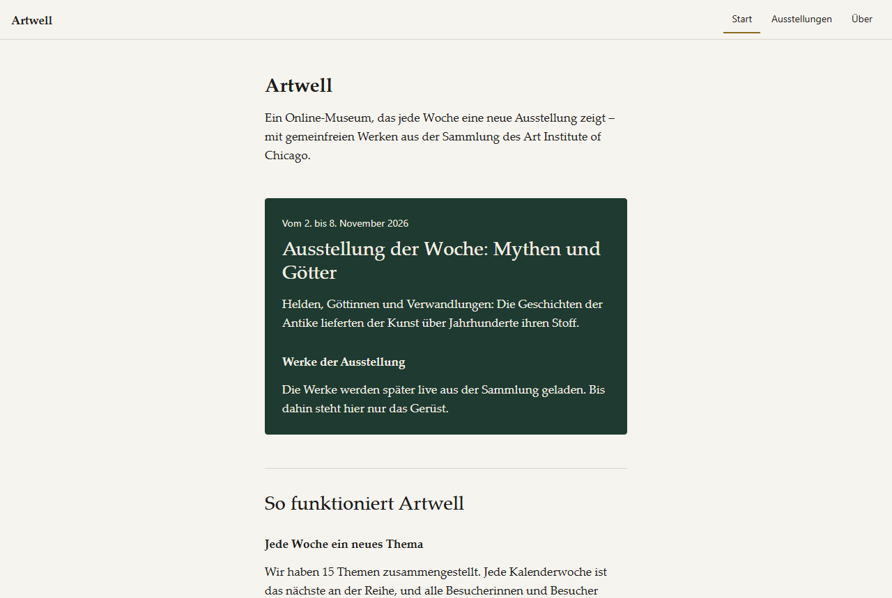

# Artwell – das Online-Museum

Artwell ist ein Online-Museum mit Werken aus der Sammlung des Art Institute of Chicago. Jede Woche öffnet automatisch eine neue Ausstellung zu einem anderen Thema, und zu jedem Bild gibt es Informationen zu Künstler, Entstehung und Hintergrund. Die App richtet sich an Kunstinteressierte, Studierende und alle, die ohne Museumsbesuch Kunst entdecken möchten.

**Live:** https://le0mkr.github.io/WebEngineering/
**Team:** Lisa Westenhöfer, Hasan Can, Leo Marker



## Was Artwell heute kann

- **Ausstellung der Woche:** Jeden Montag (nach deutscher Zeit) ist automatisch das nächste von 15 Themen an der Reihe, für alle Besucher gleich.
- **Alle Ausstellungen:** Übersicht der 15 Themen mit Einführungstext und dem nächsten Termin; die laufende Ausstellung ist markiert.
- **Thema vorschlagen:** Vorschläge erscheinen ohne Neuladen in einer Liste mit Zähler, lassen sich filtern und entfernen und bleiben in diesem Browser gespeichert. Verschickt wird nichts.
- **Für alle Geräte:** funktioniert vom Handy bis zum großen Bildschirm, hell und dunkel, vollständig per Tastatur bedienbar.

## Was noch kommt

- Die Werke einer Ausstellung als Galerie anzeigen und seitenweise durchblättern
- Eine Detailansicht mit großem Bild, Künstler, Datierung, Technik, Maßen und dem Beschreibungstext des Museums
- Frei in der gesamten Sammlung nach Titel, Künstler oder Stichwort suchen
- Kunstwerke als Favoriten speichern; die Favoritenliste bleibt im Browser (localStorage) erhalten
- *Optional / geplant:* Für Werke ohne Museumstext auf Wunsch eine KI-Beschreibung erzeugen, die deutlich als „KI-generiert, nicht vom Museum geprüft“ gekennzeichnet ist

## Datenquelle

Die Werke kommen ab Termin 7 live aus der Sammlung des Art Institute of Chicago; bis dahin zeigt die Seite die Themen ohne Bilder.

Die App nutzt die öffentliche **Art Institute of Chicago API**, die ohne Registrierung und ohne API-Key zugänglich ist. Laut API umfasst die Sammlung 133.119 Werke (Stand: Oktober 2026).

Abgefragt wird der Endpunkt `/api/v1/artworks/search`. Damit die Antworten klein bleiben, fragen wir über den Parameter `fields` nur die benötigten Felder ab: `id`, `title`, `artist_display`, `date_display`, `medium_display`, `dimensions`, `image_id`, `description`, `short_description`, `thumbnail`, `is_public_domain`, `copyright_notice` sowie für die Ausstellungsthemen `style_titles`, `subject_titles` und `theme_titles`.

Die Bilder werden über den IIIF-Bildserver des Museums geladen; die Bild-URL wird aus `config.iiif_url` und der `image_id` zusammengesetzt. Werke ohne `image_id` werden ausgeblendet. Der Text aus `thumbnail.alt_text` dient als Alternativtext für Screenreader. Bei Werken, die nicht gemeinfrei sind, zeigen wir den `copyright_notice` in der Detailansicht an.

Die Daten werden bei jedem Aufruf live von der API geladen, es gibt keine eigene Zwischenspeicherung. Aktualisierungen der Sammlung übernimmt das Museum selbst.

**Lizenz:** Die Beschreibungstexte (`description`) stehen unter CC-BY 4.0 und werden in der App mit „Text: Art Institute of Chicago“ gekennzeichnet. Alle anderen Daten stehen unter CC0.

Dokumentation: https://api.artic.edu/docs/


## Ausgeschiedene Projektideen
- **Länder-Lexikon (REST Countries):** Es gibt nur ungefähr 250 Länder und die Daten ändern sich fast nie, deshalb hätten wir für Suche und Seiten gar nicht genug Inhalt gehabt.
- **Lebensmittel-Scanner (Open Food Facts):** Spannend wäre die App nur mit Barcode-Scan über die Handykamera gewesen, und das haben wir uns in acht Wochen neben dem Rest nicht zugetraut.
- **Raumfahrt-News-Feed (Spaceflight News API):** Die API gibt zu jedem Artikel nur eine kurze Zusammenfassung und einen Link auf eine andere Seite, also hätte unsere App eigentlich nur Links weitergeleitet.
- **Währungsrechner (Frankfurter):** Mit nur etwa 30 Währungen wäre die Liste sehr kurz gewesen, und im Mittelpunkt hätte eher ein Rechner gestanden als eine Liste, die ja Pflicht ist.

## Lokal starten

Seit Blatt 4 läuft das Projekt mit Vite. Voraussetzung ist Node.js (aktuelle LTS-Version).

```bash
npm install      # einmalig: lädt Vite und Tailwind nach node_modules/
npm run dev      # Entwicklungsserver, Adresse steht im Terminal
npm run build    # fertige Seite nach dist/
npm run preview  # dist/ lokal ansehen
```

Hochgeladen wird nur der Inhalt von `dist/`. Das erledigt die GitHub Action in `.github/workflows/pages.yml`: Bei jedem Push auf `main` baut sie die Seite und veröffentlicht `dist/` auf GitHub Pages. `node_modules/` und `dist/` stehen in `.gitignore`; `package-lock.json` ist im Repository, damit alle dieselben Versionen installieren.

## Technik

Womit gebaut und warum. Eine Zeile pro Entscheidung reicht, aber es soll eine Entscheidung sein, keine Aufzählung von Buzzwords.

## KI-Log

| Werkzeug | Wofür benutzt |
| --- | --- |
| Claude Code | Code für die Übungsblätter vorschlagen, Aufgaben in drei Teile aufteilen, Seiten mit Lighthouse und im Browser prüfen |

**Ein Fall, in dem KI geholfen hat:** Für Blatt 5 sollte die Seite zeigen, welche Ausstellung diese Woche läuft. Die KI hat die Wochen fortlaufend seit einem festen Montag gezählt statt mit der Kalenderwoche zu rechnen. Dadurch springt die Reihe auch zum Jahreswechsel und in Jahren mit 53 Wochen nicht. Wir haben das mit Daten nachgeprüft, deren Thema wir kannten (5. Oktober: Porträts, 12. Oktober: Stillleben).

**Ein Fall, in dem die KI falsch lag:** Beim Umbau für Blatt 4 hat die KI in `style.css` einen Kommentar mit einem doppelten `*/` geschrieben. Dadurch wurde die Regel danach, die für den klebenden Kopf, ungültig. Gemerkt haben wir es an der Warnung „Unexpected token“ beim `npm run build`. Behoben wurde es vor dem Commit, seitdem lesen wir die Build-Ausgabe jedes Mal.

**Noch ein Fall, in dem die KI falsch lag:** Der erste Vite-Build hatte absolute Pfade (`/assets/…`). Als wir `dist/` in einem Unterordner geöffnet haben, wie später auf GitHub Pages, war die Seite ungestylt, weil CSS und JavaScript eine 404 lieferten. Die Lösung war `base: './'` in `vite.config.js`.

## Rich Results Test

Das JSON-LD im `head` der Startseite wurde mit dem [Rich Results Test von Google](https://search.google.com/test/rich-results) geprüft.


## CSS-Kollision

Die Links in der Navigation werden von zwei Regeln getroffen: `a { color: var(--akzent); }` und `.site-nav a { color: var(--text); }`.
Es gewinnt `.site-nav a`; in den DevTools ist `color` bei der Regel `a` durchgestrichen, die Links sind also textfarben und nicht golden.
Der Grund ist die Spezifität: `.site-nav a` hat eine Klasse und ein Element (0,1,1), `a` nur ein Element (0,0,1). Die Reihenfolge im Stylesheet spielt dabei keine Rolle.

## Komponenten

Drei Bausteine wiederholen sich im Projekt. Alle nutzen denselben Radius (`--radius`) und die Farben aus `:root`; jede Karte hat denselben Innenabstand (1,5 × `--abstand`), jeder Button dieselbe Größe.

| Komponente | Klasse in `style.css` | Wo sie vorkommt |
| --- | --- | --- |
| Button | `.button`, zweitrangig `.button--leise`, mehrere in `.button-bar` | „Vorschlag absenden“ in `ueber.html`, „Alle Ausstellungen ansehen“ und „Mehr über das Projekt“ in `index.html`, beide Links in `danke.html` |
| Karte | `.card` | 15 Themenkarten in `ausstellungen.html`, Formular in `ueber.html`, grüner Kasten „Ausstellung der Woche“ in `index.html` (zusätzlich `.room`) |
| Navbar | `.site-header` mit `.site-nav` | Kopf aller vier Seiten |

## Tailwind-Vergleich

Auf `ausstellungen.html` steht die Karte der aktuellen Ausstellung zweimal: oben unter „Aktuelle Ausstellung“ mit Tailwind-Klassen, unten in der Liste mit eigenem CSS (`.card`, `.badge`). Beide sehen gleich aus; nur die Terminzeile, die JavaScript seit Blatt 5 einträgt, steht allein in der Liste. Tailwind kam in Blatt 4 zuerst über das Play CDN und wird jetzt von Vite gebaut (siehe „Build mit Vite und Tailwind“).

| Tailwind-Klasse | CSS-Eigenschaft | Eigenes CSS |
| --- | --- | --- |
| `relative` | `position: relative` | `.card` |
| `rounded-karte` | `border-radius: var(--radius)` | `.card`, `.badge` |
| `border` | `border-width: 1px; border-style: solid` | `.card` |
| `border-linie` | `border-color: var(--linie)` | `.card` |
| `bg-flaeche` | `background-color: var(--flaeche)` | `.card` |
| `p-6` | `padding: 1.5rem` | `.card` (1,5 × `--abstand`) |
| `absolute top-0 right-4` | `position: absolute; top: 0; right: 1rem` | `.badge` |
| `-translate-y-1/2` | `translate: 0 -50%` | `.badge` (`transform: translateY(-50%)`) |
| `px-2` | `padding-inline: 0.5rem` | `.badge` |
| `bg-akzent`, `text-grund` | `background-color: var(--akzent)`, `color: var(--bg)` | `.badge` |
| `font-ui`, `text-klein`, `font-semibold` | `font-family: var(--schrift-sans)`, `font-size: var(--schrift-klein)`, `font-weight: 600` | `.badge` |
| `mt-0`, `mb-4`, `mb-0` | `margin-top: 0`, `margin-bottom: 1rem`, `margin-bottom: 0` | `h3`, `p`, `.card > :last-child` |
| `leading-[1.2]` | `line-height: 1.2` | `h3` |

Die Namen `flaeche`, `linie`, `akzent`, `grund`, `karte`, `ui`, `klein` und `normal` sind keine Tailwind-Standardwerte. Sie werden in `style.css` mit `@theme` auf unsere Variablen gelegt. So nutzen beide Karten dieselben Werte, und der Dunkelmodus gilt auch für die Tailwind-Karte.

Damit beides zusammenpasst, steht `style.css` in der Ebene `@layer eigen`: Tailwinds Grundstile verlieren gegen unser CSS, Tailwinds Utility-Klassen gewinnen.

## Build mit Vite und Tailwind

`npm run build` erzeugt in `dist/` die vier HTML-Seiten, `robots.txt`, `sitemap.xml` und `llms.txt` (aus `public/`) sowie in `dist/assets/` eine CSS- und eine JavaScript-Datei mit einem Hash im Namen.

Die CSS-Datei ist **11,6 kB groß, komprimiert (gzip) 3,3 kB**. Davon stammen etwa 6,4 kB von Tailwind, der Rest ist unser eigenes CSS.

Sie bleibt so klein, obwohl Tailwind tausende Klassen kennt, weil Tailwind beim Build die Projektdateien durchsucht und nur die Klassen erzeugt, die dort wirklich vorkommen. Bei uns sind das gut 20 Klassen der Vergleichskarte. Dazu kommen Tailwinds Grundstile (Preflight) und die verwendeten Theme-Variablen. Außerdem entfernt Vite beim Build Kommentare und Leerzeichen.

## Lokal und live

Die Seite sah lokal und auf GitHub Pages von Anfang an gleich aus, und im Network-Tab der Live-Seite kommt kein Request mit 4xx oder 5xx zurück. Diese drei Fallen haben wir vorher vermieden:

1. **Pfade:** Live liegt die Seite unter `/WebEngineering/`, lokal unter `/`. Vite baut deshalb mit `base: './'`, also mit relativen Pfaden (`./assets/…`). Mit absoluten Pfaden (`/assets/…`) hätten CSS und JavaScript auf `le0mkr.github.io/assets/…` gezeigt und eine 404 geliefert; genau das ist uns beim ersten Probe-Build in einem Unterordner passiert.
2. **Groß- und Kleinschreibung:** Alle Dateinamen sind klein und ohne Umlaute (`ueber.html`, `favicon.svg`), und jeder Link schreibt sie genauso. Windows unterscheidet das nicht, der Server von GitHub Pages schon.
3. **Favicon:** Ohne Angabe fragt der Browser `/favicon.ico` an der Wurzel der Domain an, also außerhalb unseres Repos, und bekommt eine 404. Jede Seite verlinkt deshalb ihr eigenes `favicon.svg`.

## Keine Geheimnisse im Repo

Wir haben das Repository samt der ganzen Git-Historie nach API-Keys, Passwörtern und Tokens durchsucht (`git grep -iE "api[_-]?key|secret|token|passw" $(git rev-list --all)`). Gefunden wurde nur der Satz „ohne API-Key“ in dieser README. Die API des Art Institute braucht keinen Schlüssel, eine `.env` gibt es bisher nicht und wurde nie committet. Falls später doch ein Geheimnis dazukommt, gehört es in `.env`; die Datei steht schon in `.gitignore`.

## Mini-Server (Bonus)

Im Ordner `server/` liegt ein kleiner Node-Server ohne zusätzliche Pakete. Er nutzt dieselben Themen (`js/themen.js`) und dieselbe Wochenlogik (`js/woche.js`) wie die Seite.

```bash
npm run server   # startet auf http://localhost:3000
```

| Route | Antwort |
| --- | --- |
| `/api/themen` | alle 15 Themen |
| `/api/themen?suche=wasser` | nur Themen, deren Titel oder Einführung den Suchbegriff enthält (eigene Route mit gefilterten Daten) |
| `/api/themen/aktuell` | das Thema dieser Woche mit Start- und Enddatum |

Ein eigener Server ist nötig, sobald etwas geheim bleiben oder bei jeder Anfrage neu berechnet werden muss, etwa ein API-Schlüssel, eine Datenbank oder gespeicherte Formulareingaben. Solange alle Dateien für alle Besucher gleich sind und der Browser den Rest selbst erledigt, wie bei Artwell mit der offenen Museums-API, reicht GitHub Pages.

## Interaktion (Blatt 6)

Das Formular „Thema vorschlagen“ auf `ueber.html` lädt nicht neu: `js/vorschlaege.js` fängt das `submit`-Event ab (`event.preventDefault()`), liest die Felder mit `FormData`, prüft sie und schreibt das Ergebnis mit `textContent` in die Seite. Ohne JavaScript führt das Formular wie früher zu `danke.html`.

- **Ein Zustand:** Alles, was die Anzeige bestimmt, steht im Objekt `zustand` (`vorschlaege`, `filter`, `meldung`).
- **Eine Zeichenfunktion:** `zeichne()` baut Liste, Zähler, Filter und Meldung jedes Mal komplett aus dem Zustand. Jede Änderung (hinzufügen, entfernen, filtern) läuft über `aendere()`, das speichert und dann `zeichne()` aufruft. Deshalb passen Liste und Zähler auch nach dem Löschen zusammen („1 von 3 Vorschlägen passen zum Filter“).
- **Über den Reload hinweg (Bonus):** Die Vorschläge stehen im `localStorage` unter `artwell.vorschlaege`, zusammen mit einer Versionsnummer. Beim Start wird alles geprüft: kaputtes JSON, eine andere Version oder Einträge mit falschen Feldern werden verworfen, und die Seite sagt das in einem Satz, statt abzustürzen. Klappt der Zugriff gar nicht (privates Fenster), läuft die Seite ohne Speicher weiter.
- **Fehlersuche:** Die Notizen zu den fünf Fehlern aus dem Baustein `t6-fehlersuche` stehen in [`notizen/fehlersuche.md`](notizen/fehlersuche.md).
